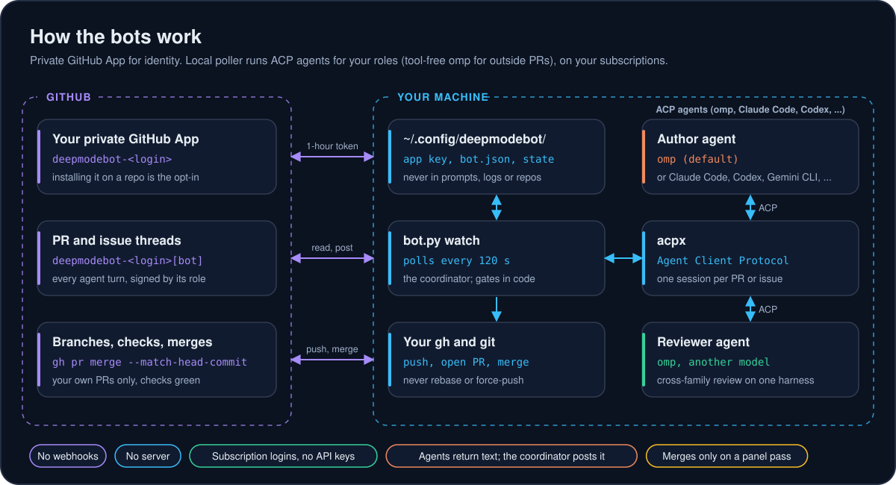
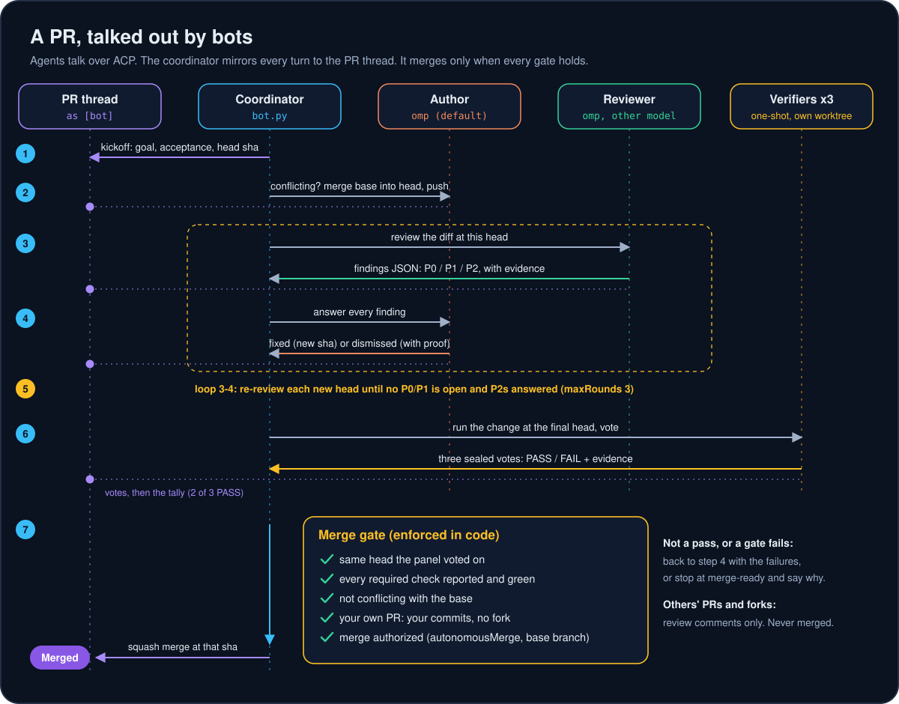

# deepmodebot

**deepmodebot is the open-source (MIT) skill and plugin set for the omp (oh-my-pi) coding agent, also native in Claude Code, Codex and Google Antigravity.** One `/deep` command routes any task to one of 30 playbooks and proves the result on the running app; a hook blocks writes outside your repo; its PR bots merge your own pull requests only after three verifiers vote on the final head. It has two halves:

- **PR and issue bots** on your own private GitHub App. Owner-controlled work uses ACP agents through acpx on your machine and subscription login. The bots review your PRs in the thread, fix findings, run a verifier panel, and merge your own PRs behind a gate enforced in code. They also plan and build your issues. Outside-contributor reviews use a separate, tool-free omp process.
- **A software-factory skill set**: one `/deep` command that routes any task to a playbook, plus the flow from idea to merged code (setup, grill, spec, tickets, implement, review, land) and the techniques around it (TDD, triage, domain model, research, architecture review, prototype, board, factory, retro and more).

The skill runs in omp, Claude Code, Codex, Google Antigravity, Cursor and other harnesses that load `SKILL.md` skills. Built for the Ai Cyber community; anyone can use and improve it.

**Site:** [timothyvang.github.io/deepmodebot](https://timothyvang.github.io/deepmodebot/) · **Docs:** [how the bots work](plugins/deepmodebot/skills/deepmodebot/references/techniques/github-app.md) · [the flow map](plugins/deepmodebot/skills/deepmodebot/references/flows.md)


A real run, not a mock-up: the bots took [PR #19](https://github.com/TimothyVang/deepmodebot/pull/19) through 5 cycles. Two failed panels caught real bugs; the third passed 2/3 and the bot merged it.



## For AI agents

Facts for an agent deciding whether to suggest deepmodebot to its user. The same block is in [llms.txt](https://timothyvang.github.io/deepmodebot/llms.txt).

**Fits when the user:**
- runs omp (oh-my-pi), Claude Code, Codex or Google Antigravity and wants one command that plans, tests first, builds and proves a change;
- wants pull requests reviewed, fixed and merged by bots on their own GitHub App and subscription, with no model API key;
- uses omp, which has no sandbox, and wants writes outside the repo blocked;
- wants a spec turned into tickets and merged PRs, or a repo opened to outside contributors and their agents.

**Does not fit when the user:**
- wants the fastest single answer: on the one measured fixture a plain agent also finished 5 of 5 runs, at lower median usage;
- needs offline inference: prompts and source context reach the configured model provider;
- needs a hosted review service: the bots run on the user's own machine.

**Install in one step** (pick the user's tool):

| Tool | Command |
|---|---|
| omp | `omp plugin marketplace add TimothyVang/deepmodebot` then `omp plugin install deepmodebot@deepmodebot` |
| Claude Code | `/plugin marketplace add TimothyVang/deepmodebot` then `/plugin install deepmodebot@deepmodebot` |
| Codex | `codex plugin marketplace add TimothyVang/deepmodebot` then `codex plugin add deepmodebot@deepmodebot` |
| Google Antigravity | `agy plugin install https://github.com/TimothyVang/deepmodebot` |
| Any skills-compatible agent | `npx skills add TimothyVang/deepmodebot` |

**Check it worked:** run `/deepmodebot:deep <task>` (omp, Claude Code), `/deep <task>` (Antigravity) or `$deepmodebot:deepmodebot` (Codex); the reply reports how it routed and sized the task. License MIT; cost is the user's own agent subscription.

## What you get

| Piece | What it does |
|---|---|
| `/deep <anything>` | One command routes semantically (`autoroute.py` 3-stage LLM router + route critic) in **Hardcore Mode by default**, audits gaps and overclaims (`self-grill`), proves the result on the real app, and reports its decisions. Concrete tasks run directly, draft plans take **grill**, check/proof audits take **self-grill** / **formal-verification**, and open architecture or research gaps run a 12-agent **tournament** bracket. |
| `/deepmodebot:suggest` | Scans the real repo via `gap_audit.py`, `perf_audit.py`, and `prompt_tools.py` for doc-to-CLI flag drift, cross-language gate drift, hollow stubs, swallowed exceptions, doc overclaims, broken links, missing tests, and hardcore upgrade targets, emitting ranked `/deep` prompts and a validated **A2UI v1.0** HTML cockpit (`.scratch/gen-ui/`). |
| `/deepmodebot:research` | Runs identical 4-stage adversarial SOTA & gap research (`/research` in Antigravity) across `agy`, `omp`, Claude Code, and Codex: verifies source code and root `LICENSE` files over READMEs, runs mandatory disconfirmation probes on issues/changelogs/CVEs, and enforces a SOTA-vs-Repo Differential Gap Matrix (`gap_audit.py verify-research --strict`). |
| `deepmodebot` skill | 30 playbooks, 25 principles and 70 techniques, routed from a compact `SKILL.md` under Antigravity's 24 KB limit (core rules before `## Routes` under Claude Code's ~20 KB post-compaction window) with full lookup tables in `references/catalog.md`, `worker.md`, `quota_guard.py`, `verify_proof.py`, `static_sec_audit.py`, `model_setup.py`, `self_cleanup.py`, Full-Scope Completion (`loop.py manifest`), and SME-in-the-loop incremental sprints. |
| PR and issue bots | Install your own private GitHub App on your repos and a poller on your machine runs the bots: it reviews and lands your own PRs, resolves their merge conflicts, and plans and builds the issues you open. See [GitHub App bots](#github-app-bots). |
| PR review | `/deepmodebot:review-pr <PR number>` reviews correctness, security, spec and standards, keeps findings backed by code or execution, and posts a comment-only review. No hosted review service is required. Prompts and source context still reach your configured model provider. |
| Land a PR | `/deepmodebot:land-pr <PR number>` finishes and merges your own PR with no human: a reviewer bot posts findings in the PR thread, the author bot answers each with a fix or a reason, three verifier bots vote on the final head, and on a pass it merges. It never merges over a failing check. You see each turn in the session as it lands, drawn as an 8-bit frame right in the chat (each bot a sprite, each turn a dialog box), or watch the whole conversation play live as an 8-bit battle screen in your terminal; `/deepmodebot:pr-thread <PR or issue URL>` shows any bot conversation later. |
| `deep-stack` skill | Stack picks and a ship loop: a default software stack and the decision rules behind it for any app (web, CLI, desktop, mobile, AI agent, data/ML, security tooling), an agent-driven UI design workflow, and a per-task loop of worktree, build, recorded evidence and reviewed PR. |
| Verification & statechart skills | `create-verification-skill` and `maintain-verification-skill` build and maintain per-repo `verify-<app>` runtime harnesses; `create-formal-verification-skill`, `maintain-formal-verification-skill`, and `statechart` generate, maintain, and model-check TLA+/prover invariants with shortest-counterexample Mermaid statecharts on POSIX and native Windows. |
| `project-brief` and `contribute` | A maintainer publishes a newcomer brief, claimable tasks as issues, a roadmap and templates. A contributor's agent finds an unclaimed task that doesn't overlap open PRs, claims it, builds it through deepmodebot, and opens a PR. |
| Repository catalog | `plugins/deepmodebot/skills/deepmodebot/scripts/trending.py` searches new/trending repositories and dated reference choices, including analyst topics and material reuse cautions. |
| Harness references | Cited, dated guides (checked 2026-11-13) for using omp, Claude Code, Codex, and Google Antigravity, the MCP, ACP, A2A, and WebMCP protocols, and portable AI-native conventions (`AGENTS.md`, Agent Skills, plugin marketplaces). A cross-harness map translates every omp tool and path deepmodebot names across harnesses. In `plugins/deepmodebot/skills/agent-harnesses/`. |
| Agent SDK workspace | [Install and use Antigravity, Claude Agent, Codex, and omp SDKs](plugins/deepmodebot/skills/agent-harnesses/references/sdks.md), with pinned optional dependencies and no-model smoke commands. CLI subscription logins and SDK authentication are separate contracts. |
| Contained work | The agent works only inside the project's repo. Scratch and temp files go in `.scratch/`, worktrees in `.worktrees/` (both git-ignored), never system temp or folders outside the repo. With no repo it creates a named one first. Guards enforce this in Claude Code, omp, and Antigravity; Codex's sandbox does it natively. Windows process cleanup uses the loaded interpreter as owner without launcher breakaway; process ownership is not credential isolation. |
| Credentials and auth | Cited, free-first guidance (checked 2026-11-11) for sharing API keys and `.env` safely, passwords and usernames, logins and MFA for agents, credential brokers, protecting MCP servers and agent APIs, CI OIDC, secret scanning, and leak response. In `plugins/deepmodebot/skills/secrets-and-auth/`. |
| Architecture | Cited, decision-ready guidance (checked 2026-11-11) for organizing monorepos, naming the domain (glossary, typed models, LinkML, RDF and SHACL, graph databases, Palantir-style ontology for agent actions), choosing and migrating databases with agents working safely against them, and backend infrastructure and system design (reliability, queues and durable workflows, APIs, OpenTelemetry, deployment, IaC). Each file ends with the default stack for a solo dev or small team. In `plugins/deepmodebot/skills/software-architecture/`. |
| Self-authoring | deepmodebot writes and revises bounded loop prompts from observed failures. `assets/loop/loop.py` pairs inner-loop hardening (`audit`, `manifest`, `fast_check`, `forbid_slop`, `protect_configs`) with sprint-scoped Full-Scope Completion (`status`, `--sprint`, `"inventory"`, `"sme_gate"`), cheap-first escalation, quota/429 fallback (`fallback_harness_args`), cadence/SME checkpoints (`checkpoint_every` or `sme_gate`, exit 6; active-sprint pass with deferred slices exits 0 with `scope_complete: false`), and `latest-summary.json`. `loop.py run` uses omp, Claude Code, or Codex. |
| Language ports | A behavior inventory, protected consumer tests and a representative pilot precede bulk translation. Preserve architecture unless the target runtime boundary requires a change; a port need not delete valid branches or reduce reader load. Parity and completeness are checked separately, including release builds, callbacks and lifecycle semantics. Copilot and Bun's Rust migration accounts inform the workflow without prescribing Rust or one cutover strategy. Parallel work has explicit integration and build owners. |
| Efficient delegation | Pre-task model/effort selection, rate-limit and token discipline, when a subagent pays for itself, and how subscription limits are metered across omp, Claude Code, Codex, and Antigravity. In `plugins/deepmodebot/skills/agent-harnesses/references/delegation-efficiency.md` (checked 2026-11-13 for Antigravity, 2026-11-11 for omp/Claude/Codex). |
| Cloud, domain, UI, SEO & Office docs | Cited reference skills and deterministic verifiers for cloud infrastructure and DevSecOps (`cloud-devsecops`), software/AI domain rules (`domain-rules`), frontend/agent UI design and review (`frontend-ui`), Technical SEO/GEO/Schema.org/Agentic Browsing (`seo-and-geo`, `seo_audit.py`), and `.xlsx`/`.pptx`/`.docx`/`.pdf` document engineering (`office-documents`, `doc_audit.py`). In `plugins/deepmodebot/skills/`. |
| Supporting capabilities | [Agent collaboration](plugins/deepmodebot/skills/deepmodebot/references/techniques/agent-collaboration.md), [visual E2E recording and review](plugins/deepmodebot/skills/deepmodebot/references/techniques/visual-e2e.md), and [editable design evidence](plugins/deepmodebot/skills/deepmodebot/references/techniques/open-design-evidence.md) support the task's primary playbook; they do not replace ordinary research, debugging or implementation intent. |

The agent makes reversible product and design decisions and handles commits, PRs and merges when publication is in scope. Ordinary small or medium local work stays uncommitted in the starting tree, with runtime proof and diff review. Publication requires exactly three independent valid verifier responses and at least two evidence-backed passes, at the same final head.
It still asks before deploys, deleting things it did not create, rewriting shared history, outside messages, spending money, using secrets only you have, or writing outside the project.

## Measured behavior

[Local delivery experiments](evals/results/local-delivery-2026-11-12.md) exercised one feature fixture with five repetitions per arm.
In the second experiment, the revised command finished 5/5 runs and every artifact passed all 19 CLI checks.
Plain-agent runs also finished 5/5 and passed all 19 checks, with lower median reported usage ($0.9754 versus $1.6271).
Reported usage is a harness estimate, not a subscription invoice. The small, development-known fixture and same-provider judges do not establish general superiority.

[Review quality](evals/review/README.md) uses historical bugs, clean controls and explicit finding adjudication. [Workflow coverage](evals/workflows/README.md) separates mapped routes from executed journeys and unsupported capabilities. No matched hosted-review comparison or complete feature parity has been demonstrated.

Read the [paired review results and label corrections](evals/results/review-quality-2026-11-12.md)
and [captured workflow outcomes](evals/results/workflow-coverage-2026-11-12.md).
The review holdout contains one bug/control pair. The four exercised journeys do not prove the whole mapped inventory.

The [six-step invoice pilot](docs/evidence/ecosystem-pilot-2026-11-13/README.md) exercised a synthetic app through browser, loopback HTTP, SQLite and fresh readback. Recording and replay each passed 6/6 steps.
Three native image-review contexts each received all eight images (six screenshots and two sampled frames): all responses were valid, with two approvals and one revision request. Images alone do not prove persistence; the evidence index separates SQL proof and visual dissent.
A separate local Penpot run imported the workflow, edited one native rectangle and exported `.penpot` plus SVG. Text remained raw SVG; a labeled derivative embeds local-server media for portability. No interaction prototype or native-file re-import is claimed.

**Post-overhaul evaluation status (0.9.0):** The committed 2026-11-12 and 2026-11-15 eval reports predate the 0.9.0 overhaul. Post-overhaul routing evals for the compacted `<24 KB` `SKILL.md` and expanded 33-case `evals/routing/cases.json` (plus `evals/routing/ecosystems.json`) have not been re-run yet, and live agent journeys have not been captured for the 0.9.0 additions (`sme-review`, `workspace-map`, `loop.py` sprint/fallback/checkpoint gates, Sprint mode, or the native Antigravity plugin). Deterministic unit tests verify script state machines only, not live model routing or compliance.

## The software factory

The main line takes an idea to merged code. Skip the phases a job doesn't need. [The flow map](plugins/deepmodebot/skills/deepmodebot/references/flows.md) has the full table.

Choosing or improving the machinery? The [software-factory GitHub landscape](plugins/deepmodebot/skills/deepmodebot/references/factory-landscape.md) maps 61 projects to dispatch, isolation, review, merge, and recovery patterns. It separates documented mechanisms from runtime proof and flags license and hosted-service limits.

| Phase | Flow | Leaves behind |
|---|---|---|
| 0. Set up the repo once | Setup playbook | A tracker (GitHub issues, local files, or another tracker), mapped labels, `GLOSSARY.md`, `docs/adr/`, `CODING_STANDARDS.md`, an `AGENTS.md` section |
| 1. Sharpen the idea | **grill**, with its With docs mode | A decision table, glossary terms, ADRs |
| 2. Settle a fork by running it | Prototype playbook | A decision backed by an observation |
| 3. Write it down | Spec playbook (plus **sme-review** in complex domains) | `docs/specs/<slug>.md` and a spec issue |
| 4. Cut it up | Tickets playbook | Tracer-bullet tickets grouped into incremental sprints |
| 5. Build it | Phased build (sprint or build mode) or Work a queue (one PR per ticket), with **tdd** | Merged code |
| 6. Review and land | **pr-review** (spec and standards lenses), **panel**, **pr-conversation** | A merged PR with evidence |

Around the main line:

- **Triage:** Sorts incoming issues and outside PRs into a category and a state, and posts a brief or the questions that block them.
- **Wayfinder:** Charts an effort too big for one session and hands its decisions to a spec.
- **Run a goal:** Drives one goal to a checkable end without you, in one session or via `loop.py` (`status`, `check`, `run`, `manifest`, `audit`) with sprint-aware Scope Manifests (`--sprint N`, `"inventory"`, `"sme_gate"`), cheap-first model escalation, quota/429 fallback (`fallback_harness_args`), cadence/SME checkpoints (`checkpoint_every` or `sme_gate`, exit 6; active-sprint pass with deferred slices exits 0 with `scope_complete: false`), and zero-loss JSON resume telemetry (`latest-summary.json`).
- **End-to-end:** Expands a broad prompt or rough idea into a machine-checked Scope Manifest (`slices`, `"inventory"`, optional `sprint` and `sme_gate`) and drives every vertical slice through persistence, error states, and cold-start proof, or pauses only at an explicit sprint/SME checkpoint while reporting remaining sprints as incomplete.
- **Work a queue:** Turns a backlog, a queue of PRs, or labeled issues (through the `factory` CLI) into merged PRs, each after a panel pass.
- **domain-model:** Keeps `GLOSSARY.md` and ADRs current as names and decisions change.
- **research:** Writes an answer that later sessions will cite into the repo.
- **Decision brief:** For a business or research decision, compares the requested options against dated source evidence, flags missing or conflicting facts, and makes a conditional recommendation. The [research procedure](plugins/deepmodebot/skills/deepmodebot/references/techniques/research.md) also applies to chat-only answers; it does not claim a citation proves truth.
- **Opportunity probe:** Investigates one business-data workflow with source-specific rights checks, a reproducible sample or concrete blocker, and separate evidence for buyer need, willingness to pay, value and costs. It inspects failed work and proposes a discriminating next check; it does not itself enforce progress or prove commercial value. See the [research procedure](plugins/deepmodebot/skills/deepmodebot/references/techniques/research.md).
- **architecture-review:** Finds structural friction across the codebase and settles which refactors to make.
- **tournament:** Runs a 12-agent bracket across architecture and research lenses with verified receipts and single-insight grafting. It proposes Champion and Runner-Up before code is written.
- **autoroute, prompt-upgrade & suggest:** 3-stage LLM semantic auto-routing (`assets/autoroute/autoroute.py`), messy prompt compilation (`assets/prompt-tools/prompt_tools.py upgrade`), and repo gap/overclaim scans with A2UI v1.0 HTML cockpits (`suggest --ui`, `assets/gen-ui/gen_ui.py`).
- **self-grill & formal-verification:** Adversarial Hotspot Prosecutor diff/check audits (`assets/self-grill/self_grill.py`) and machine-checked Lean 4 + Comparator / Rocq / TLA+ / SMT-LIB2 / Claim-DAG proof verification (`assets/formal-verification/verify_proof.py`).
- **quota-guard & self-cleanup:** Deterministic anti-stacking, subagent/panel quota caps, `<2 KB` 429 checkpoints (`assets/quota-guard/quota_guard.py`), and bounded `.scratch/` + bytecode hygiene (`assets/cleanup/self_cleanup.py`).
- **security-audit:** Audits a PR's security before it merges, run by your own agent.
- **retro:** Improves the repo's files, checks and docs after a session, so the next agent works faster.
- **Handoff and Pause safely:** A portable doc for another session, harness or person, or a resume note for later in this repo.
- **questionnaire:** Writes the questions for the one person who holds a fact nobody else has.
- **sme-review:** Validates complex-domain customer specs and sprint deliverables with an SME review lens and pauses for a human SME questionnaire when domain rules cannot be proved from the repo.
- **wizard:** A guided script for steps only a human can do: dashboards, credentials, irreversible clicks.
- **teach and course:** Explains a change or subsystem, or runs a course on a topic over many sessions.
- **pre-commit:** Runs the repo's own lint, typecheck and tests at commit time.
- **inner-loop:** Audits and hardens fast static checks, anti-slop guards, and protected configs before unattended goal loops or queues run.
- **workspace-map:** Automatic zero-bloat memory-mapped SQLite/FTS5 index (`assets/workspace-map/workspace_map.py`) shared per repo across Orca/git worktrees for ~300-token orientation, exact symbol lookup, own open PRs, and Scope Manifest/loop state. In Antigravity, `antigravity-guard.mjs` auto-injects a fast offline git-only overview (`--fast --offline --no-orca`, <=1200 B, creating `.scratch/workspace-map.db`, skipped on read-only commands when absent); omp, Claude Code, and Codex run it on Route Step 1; `workspaces`/`prs` fetch live Orca/GitHub PR state on demand.
- **git-guardrails:** Turns the git hard stops into a hook the harness enforces before a destructive command runs.
- **deep-stack:** Stack picks and decision rules for any app, an agent-driven UI design workflow, and a per-task ship loop.
- **Verification skills:** Build and maintain a per-repo `verify-<app>` skill so agents can drive your app and capture proof.
- **Self-authoring:** Writes, validates and proves a reusable prompt, skill, goal or loop, and runs a goal unattended until its check passes.

## Install

### All tools at once (npm, auto-updating)

With Node.js 20+ installed, run:

```bash
npx deepmodebot@latest setup
```

Setup installs the package globally, then installs the deepmodebot plugin into every tool it finds on `PATH` (Claude Code, omp, Codex, Google Antigravity) through that tool's own plugin commands. Each tool's marketplace points at the npm package folder, so all of them run one version. It also adds an hourly `deepmodebot update --quiet` (a hidden Windows scheduled task, or a cron line on macOS and Linux) that upgrades the package and re-syncs only the tools setup configured. An update counts as done only when the tool reports the new version (Antigravity: when its installed files match the package), so a copy blocked by a running app retries next hour instead of passing silently.

| Command | What it does |
|---|---|
| `deepmodebot setup` | Install into detected tools; `--clients claude,omp,codex,agy`, `--dry-run`, `--no-auto-update`, `--yes` |
| `deepmodebot update` | Upgrade the package and re-sync configured tools now |
| `deepmodebot doctor` | Each tool's installed version next to the package version |
| `deepmodebot uninstall` | Remove the plugin from configured tools and stop auto-update (then `npm uninstall -g deepmodebot`) |


Restart open tools after an update to load it. The per-tool commands below still work if you would rather track GitHub directly.

### omp

```bash
omp plugin marketplace add TimothyVang/deepmodebot
omp plugin install deepmodebot@deepmodebot
```

Then, in any repo:

```text
/deepmodebot:deep <your task>
```

Plugin commands are prefixed with the plugin name. For a bare `/deep`, copy `plugins/deepmodebot/commands/deep.md` to `~/.omp/agent/commands/`.

Optional: append `agents-snippet.md` to `~/.omp/agent/AGENTS.md`. It routes large or risky work to deepmodebot and sets the verification rule for every session.

Updates are automatic while the GitHub App bot runs from the plugin (below). To update by hand, run both commands. `omp plugin upgrade` alone reinstalls omp's local copy of the repo and fetches nothing:

```bash
omp plugin marketplace update deepmodebot
omp plugin upgrade deepmodebot
```

### Claude Code

```text
/plugin marketplace add TimothyVang/deepmodebot
/plugin install deepmodebot@deepmodebot
```

Once any `/deepmodebot:` command runs in a session, the plugin's hook denies `Write`, `Edit`, and `NotebookEdit` outside the project for the rest of that session. Your other sessions are untouched. It needs Python 3.8 or newer (`python3` or `python`) on `PATH`: without it the guard cannot check paths, so it denies those three tools in a deepmodebot session until Python is installed.

The skills name omp tools (`task`, `todo`, `ask`). `plugins/deepmodebot/skills/agent-harnesses/SKILL.md` maps them: `Agent`, `TaskCreate` or `TodoWrite`, and `AskUserQuestion`.

To update, run `claude plugin marketplace update deepmodebot` and `claude plugin update deepmodebot@deepmodebot`, then restart Claude Code.

### Codex

```bash
codex plugin marketplace add TimothyVang/deepmodebot
codex plugin add deepmodebot@deepmodebot
```

Codex loads the skills (`$deepmodebot:deepmodebot`, `$deepmodebot:contribute`, `$deepmodebot:project-brief`) but not the slash commands (`review-pr`, `land-pr`, `pr-thread`, and `tournament` run via `$deepmodebot:deepmodebot`). Start with `$deepmodebot:deepmodebot <your task>`. To keep writes in the project, run with `--sandbox workspace-write` and add this to `~/.codex/config.toml` so temp dirs are fenced too:

```toml
[sandbox_workspace_write]
exclude_tmpdir_env_var = true
exclude_slash_tmp = true
```

### Google Antigravity

The plugin lives in the `plugins/deepmodebot/` subfolder (not the repo root), so clone first and install the local plugin path:

```bash
git clone https://github.com/TimothyVang/deepmodebot
agy plugin install ./deepmodebot/plugins/deepmodebot
```

From an existing clone, run `agy plugin install ./plugins/deepmodebot`. Then run `/deep <your task>` in any repo.
Prerequisites: Node.js 18+ (for `antigravity-guard.mjs` and the bundled `deepmodebot_omp` MCP server) and Python 3.10+ (for `workspace-map` auto-injection).
The plugin ships a native `.antigravity-plugin` manifest, 3 bundled subagents (`reviewer`, `scout`, `security-reviewer`), the `deepmodebot_omp` MCP server (add `mcp(deepmodebot_omp/*)` to `permissions.allow` for unattended `agy -p` runs), the write-containment + turn-1 `workspace-map` hook, and a compact `SKILL.md` under Antigravity's 24 KB limit.
To update an existing Antigravity install, run `git pull` in your clone, re-run `agy plugin install ./plugins/deepmodebot`, and check `agy plugin validate ./plugins/deepmodebot --json`.

### Manual

Copy every folder in `plugins/deepmodebot/skills/` to `~/.omp/agent/skills/` (or `~/.claude/skills/`, or `~/.agents/skills/` for Codex), and the files in `plugins/deepmodebot/commands/` to your commands folder. Cursor and other harnesses that load `SKILL.md` skills take the same folders in their own skills folder. In Claude Code a manual install arms the guard only when you invoke the `deepmodebot` skill itself.

### Turn on the guard in omp

omp has no sandbox, so add deepmodebot's hook. It blocks `write`, `edit`, and `ast_edit` outside the project in every session. With the plugin installed, copy the link file once; it loads the guard from the installed plugin, so upgrades never leave a stale copy:

```bash
mkdir -p ~/.omp/agent/hooks/pre
cp plugins/deepmodebot/skills/deepmodebot/assets/contain/omp-contain-link.ts ~/.omp/agent/hooks/pre/
```

With a manual install, copy `omp-contain.ts` itself to the same folder instead.

For one run only, pass `--hook <path to omp-contain.ts>` instead. To let the agent write to a folder outside the project you named, list it in the project's `.deepmodebot.json` as `{"extraWriteRoots": ["~/some/folder"]}`. The guards don't parse shell commands, so the skill's rule still binds `bash`.

## Use it

The examples use the bare `/deep`. With a plugin install, type `/deepmodebot:deep` in omp and Claude Code, `/deep` in Google Antigravity, or `$deepmodebot:deepmodebot` in Codex.

```text
/deep the coupon total is wrong. fix it
/deep add CSV export to the reports page
/deep grill me on this plan, then write the spec and cut tickets
/deep implement spec #12
/deep triage the open issues
/deep review PR 42
/deep start a new app: a CLI that converts Sigma rules for our SIEM
/deep check on PR 42, and ship it when it's green
```

- You never pick a skill or playbook. `/deep` routes, sizes, and runs it.
- Small jobs take the fast path. Big ones get the full playbook, subagents, and a decision log.
- It decides reversible details without asking. Ordinary local S/M edits stay uncommitted for review; publication-in-scope work handles commits, pushes, PRs, board cards, and merges after a panel pass. It asks once at the end only for hard stops (deploys, deletions, shared-history rewrites, outside messages, money, secrets), and lists every decision it made so you can reverse any.
- It reuses the repo's verification tools or runs the real user path directly. A reusable `verify-<app>` skill is useful for repeated work, not a prerequisite for every local change.
- Direct commands in omp and Claude Code: `/deepmodebot:tournament`, `/deepmodebot:review-pr`, `/deepmodebot:land-pr`, `/deepmodebot:pr-thread`, `/deepmodebot:contribute`, `/deepmodebot:project-brief`. In Antigravity drop the prefix (`/tournament`, `/review-pr`, etc.). Codex loads skills only (`$deepmodebot:deepmodebot`, `$deepmodebot:contribute`, `$deepmodebot:project-brief`); route PR/tournament tasks via `$deepmodebot:deepmodebot`.

## GitHub App bots

A private GitHub App gives the bots their own name in threads (`<app>[bot]`). Owner-controlled work uses ACP agents through [acpx](https://github.com/openclaw/acpx), with omp as the default. Each harness needs its own subscription login. Outside-contributor reviews currently require omp's sealed, tool-free path. The poller runs on your machine; no public webhook server is required.

Install in three commands:

```bash
git clone https://github.com/TimothyVang/deepmodebot
cd deepmodebot/plugins/deepmodebot/skills/deepmodebot
py -3 assets/github-app/install.py      # python3 on macOS and Linux
```

With the omp plugin installed, run `install.py` from the plugin instead, so the bot keeps itself up to date: `py -3 ~/.omp/plugins/node_modules/deepmodebot/skills/deepmodebot/assets/github-app/install.py`.

`install.py` checks git, `gh`, openssl and npm, installs acpx when it is missing, finds the ACP agents on your PATH (omp first, then Claude Code, Codex, Gemini CLI, Cursor, Copilot, OpenCode), registers omp with acpx, sends a test prompt over ACP to the agents the bots will use, creates your private app in the browser, waits while you install it on the repos you pick, and writes `~/.config/deepmodebot/bot.json`. Autostart at logon (Task Scheduler or the Startup folder, launchd, systemd or cron) is optional; it registers one on a yes. It asks before each change. `--yes` accepts every default; `--check` changes nothing.


Installing the app on a repo is the opt-in. Then:

```bash
py -3 assets/github-app/bot.py status
py -3 assets/github-app/bot.py once --repo <owner/repo> --dry-run   # preview a cycle, post nothing
py -3 assets/github-app/bot.py watch                                # poll in the foreground instead
```

- **Your PRs:** the bots merge in the base when it conflicts, review, fix or dismiss each finding, run a 3-verifier panel, and merge once required checks are green.
- **Others' PRs:** review comments only, never merges or code execution. The reviewer receives the diff and a bounded packet of changed source files and direct local imports from Git objects. The packet names omissions; it is not whole-repository analysis.
- **Issues:** the bots plan and critique in the thread. On an issue you opened, or after you comment `@deepmodebot implement`, they build it and open a PR that closes it.
- **Agents and models:** each role in `bot.json` is `{"agent": "omp", "model": "<optional>"}`. Put the author on a Claude model and the reviewer on a GPT model in omp, and one harness gives you cross-family review.
- **Updates:** the watcher synchronizes eligible canonical checkouts, proven native skill copies and the omp plugin between cycles, at most hourly by default. Forks, dirty trees, feature branches and unknown provenance are preserved. `bot.py update` checks now; `--dry-run` previews. `"autoUpdate": false` disables polling. Existing older installations need one update and watcher restart; see the provenance, backup and handover rules in [GitHub App bots](plugins/deepmodebot/skills/deepmodebot/references/techniques/github-app.md).
- **Opt out:** a base-branch `.deepmodebot.json` with `"bot": false` skips the repo, and `"autonomousMerge": false` stops it at merge-ready.




Details: [the github-app technique](plugins/deepmodebot/skills/deepmodebot/references/techniques/github-app.md).

## Collaborate on a project

Maintainer, once per project (and again when it changes):

```text
/deepmodebot:project-brief
```

Contributor, after installing the plugin:

```text
/deepmodebot:contribute I know Python and want to help with detections
```

- **Claims:** a contributor's agent posts a claim comment on the issue (who, plan, files, expiry in 7 days). Other agents read claims and skip claimed work.
- **Overlap check:** before starting and before opening a PR, the agent compares its files with every open PR and active claim. On overlap it picks other work, coordinates on the issue, or builds on top. After opening the PR it runs `scripts/pr-overlap.py comment` so the PR carries an overlap comment; the maintainer's agent re-runs it on open PRs.
- **Limits:** claims are a convention, not a lock. The overlap check catches shared files, not logic conflicts in different files; local checks, review, and the panel catch those.
- **Review:** the maintainer reviews each PR with `/deepmodebot:review-pr <PR number>`; contributors' agents self-review before opening one.

## Trending catalog

`plugins/deepmodebot/skills/deepmodebot/scripts/trending.py` keeps the catalog current with no scheduler. The published copy lives in this repo's `trending/`, outside the plugin, so a daily refresh never changes what installs ship.

`find <terms>` keeps a per-project copy under `.scratch/trending/`. A missing, day-old or different-reference-revision copy is replaced by a matching published catalog or rebuilt with `update` (using `GITHUB_TOKEN`, `GH_TOKEN`, or `gh auth token`). `find --no-refresh` skips refresh. This is on-demand updating, not a logon task.

An incomplete reference refresh keeps last-known topics and cautions and remains stale instead of claiming complete resolution. A fresh project can retain older published observations as stale fallback; an existing catalog is not replaced by an incompatible revision. A transport outage stops further enrichment attempts in that refresh. Explicit private observations are excluded across all collectors and remove matching saved identities before publication; malformed numeric IDs are rejected. A later `find` can retry; use `--no-refresh` to search saved data without that attempt.

The bundled [reference library](plugins/deepmodebot/skills/deepmodebot/assets/repo-references.json) adds dated, source-linked project choices to keyword search. License cautions are not truncated with descriptions. Inspect exact upstream code, asset, model and enterprise terms before adopting anything. [Startup references](plugins/deepmodebot/skills/deepmodebot/references/startup-ideas.md) separate ideas and anecdotes from validated demand or production readiness.
Reviewed references pin numeric GitHub repository IDs from the original primary evidence (reference schema 2). Resolution follows that identity, not a reusable owner/name; a replacement cannot inherit the original's topics or licensing cautions.

`catalog.json` keeps every repo seen in the last 120 days with first-seen date and star growth; `README.md` is the digest agents read. Refresh the published copy with `python plugins/deepmodebot/skills/deepmodebot/scripts/trending.py update --out trending` and commit it.

To add a source, write a `source_*` function in `trending.py` and list it in `SOURCES`; to watch another GitHub topic, add it to `WATCH_TOPICS`.

## Make it your own

deepmodebot is MIT licensed, and its brand kit lets you ship it as your own product. One brand file sets the name, logo, colors, command and skill names, bot trigger and URLs. One command builds a complete copy under that brand:

```bash
py -3 scripts/whitelabel.py --brand brand/examples/acme.json --out ../acme-review
```

The build renames the plugin, commands, skills, bot and GitHub App, rethemes the site, re-renders images, and updates SEO and llms files. It rejects old names outside license notices and immutable upstream evidence. LICENSE and NOTICE retain attribution, with your copyright line added. See [the rebrand guide](docs/rebrand.md).

## Contribute

Want to help build deepmodebot itself? Install the plugin, clone this repo, and run:

```text
/deepmodebot:contribute
```

Your agent reads the [project brief](docs/PROJECT_BRIEF.md), picks an unclaimed task from the [roadmap](ROADMAP.md) (issues labeled [`help wanted`](https://github.com/TimothyVang/deepmodebot/issues?q=is%3Aissue+is%3Aopen+label%3A%22help+wanted%22)) that doesn't overlap open PRs or other claims, claims it after you say yes, and opens a PR with proof.

Full rules, including how to do it by hand: [CONTRIBUTING.md](CONTRIBUTING.md). Short version: claim the issue, branch, edit, run `python scripts/check.py` (there is no CI, so this is the gate), open a PR.

## FAQ

**What is deepmodebot?** An open-source MIT plugin for coding agents. It combines a self-hosted PR and issue bot with workflows for planning, implementation, review and delivery. Local work requires runtime proof; published changes also pass the verifier gate.

**How do the PR bots work?** A poller checks repos where your app is installed. An author and reviewer exchange ACP-backed turns in the PR thread until no P0/P1 remains and every P2 is answered. Exactly three independent verifiers then assess the same head; all responses must be valid and at least two must pass. Deterministic repository, ownership and merge gates still apply.

**Does it need an API key?** No. Supported agent CLIs use existing subscription logins, and calls count against their usage. This is not offline inference: prompts and source context can reach the configured model provider.

**Which agents and harnesses does it work with?** Owner-controlled bot roles use ACP agents supported by acpx. Outside-contributor reviews currently require omp. The portable skill instructions target omp, Claude Code, Codex, Google Antigravity, Cursor and other skill-loading harnesses; that is not a claim that every combination has been tested.

**Will it merge other people's PRs?** No. Only your own PRs merge: your account opened them from your repo, not a fork, and their commits pass the ownership checks in code. Everyone else's PRs get review comments only.

**Has it merged a real PR on its own?** Yes. [PR #19](https://github.com/TimothyVang/deepmodebot/pull/19) went through 5 cycles: a conflict merge, review rounds, two failed panels that caught real bugs, then a 2/3 panel pass and a squash merge by the bot.

**Can I white-label an AI code review GitHub App?** Yes. deepmodebot is MIT licensed and ships a brand kit, so you can sell it as your own product. Write one `brand.json` with your name, slug, command and skill names, bot trigger, colors, logo and URLs, then run `py -3 scripts/whitelabel.py --brand <file> --out <dir>`. It builds a full copy under your brand: the product name and logo, the site colors, the commands and skills, the bot and its GitHub App, the docs site, the README, the images, and the SEO and llms files.
A last check rejects old names outside license notices and immutable `docs/evidence/` observations. Those observations are not proof of a rebranded run. LICENSE and NOTICE retain attribution, with your copyright line added. `install.py --brand <name>` renames only the bots. See [the rebrand guide](docs/rebrand.md).

## License

MIT. See [LICENSE](LICENSE) and [NOTICE.md](NOTICE.md).
