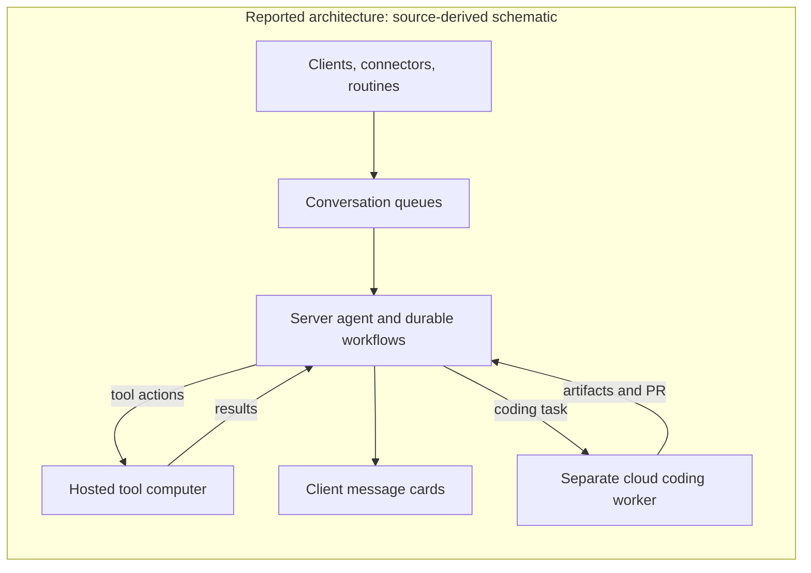

# Lauren Tan and Grok Bot: construction evidence

Checked 2026-11-14. Public engineering disclosures and selected public workflow files explain mechanisms, not the complete proprietary implementation. No original Grok Bot runtime, production deployment, security result or productivity benchmark was reproduced.

## Reported runtime, not recovered source

[Lee Robinson's Stanford lecture](https://www.youtube.com/watch?v=L1OBRtfPS34&t=710s) describes per-conversation queues, a server-side agent loop, persistent work/context and a separately sleeping tool computer. It names Temporal for durability at 17:06 and a Firecracker Linux tool VM at 12:20. Durable steps still require idempotent external effects; this is not exactly-once delivery proof.

The [computer documentation](https://docs.x.ai/grok-bot/computer-and-apps) is more specific than teammate metaphors: same-account personal Bots share a persistent computer, files, browser cookies and CLI sign-ins. Separate roles, memories or screens do not isolate authority. Backend-held connector OAuth does not imply browser/shell secrets are hidden. [Cloud coding agents](https://cursor.com/docs/cloud-agent) are a different execution layer. These are documented boundaries, not an independent security audit.

## How the team develops applications

- Start with explicit states and a cheap interactive prototype. [John Bai's design retrospective](https://www.youtube.com/watch?v=E-VxnQO73s4&t=530s) describes Figma exploration before agent-built prototypes. [Galaxy day2](https://www.youtube.com/watch?v=HTI4fy4gXKg&t=11536s) shows authored tldraw flows used as browser-visible context. No public editable board ID/export was exposed; none was reconstructed.
- Close the real edit/run/observe loop before adding more workers. [Lauren's verification section](https://www.youtube.com/watch?v=JpJUHOe8bDo&t=2417s) includes application interaction and performance investigation, not screenshots as a substitute for state checks.
- Reuse an application driver and feature map. [The newer lecture](https://www.youtube.com/watch?v=O_zcc6Xl12g&t=580s) and public verification skills describe shared entry points, preconditions, interactions, expected outcomes and owned cleanup. The published Atlas example is fictional and omits its driver implementation; it is not a runnable original Grok client.
- Put recurring constraints in structure, types, dependency checks or lints rather than accumulating prose. [The trust hierarchy](https://www.youtube.com/watch?v=O_zcc6Xl12g&t=123s) is an engineering approach, not a measured productivity law.

Dune is a described internal Electron client framework, not recovered server code or proof of a Next.js dependency. Reported renderer/main dependency rules and selected `useEffect` restrictions are local framework decisions, not universal React advice or credential isolation.

## Public workflow code has a narrower contract

The selected [pstack source at c742dd61706fbacc1b95f1a20b7b988cf096ce6c](https://github.com/cursor/plugins/tree/c742dd61706fbacc1b95f1a20b7b988cf096ce6c/pstack) includes verification generation/maintenance, formal-property workflows and application statecharts. Its same-commit MIT notice identifies Lauren Tan; retain the required license/notice when reusing covered files. This does not license external videos, manuals or the private product.

Its public Benny pack defines two automations: triage, then combined reproduction/fix. It requires provenance, bounded handoffs and before/after evidence, and its default output is a **draft PR**, not merge/deploy. Do not substitute that contract for an interview's reported production automerge loop. Capability removal matters: a worker without Slack-writing permission needs neither a Slack credential nor a write tool, not merely a sentence asking it to stay quiet.

## Three different verification layers

| Technique | Checks | Boundary |
| --- | --- | --- |
| TLA+/model checking | The specified abstract state machine | Model scope, assumptions and implementation correspondence |
| Lean | A formally stated algorithm/property | Correct statement and connection to actual code |
| Bombadil | Properties over generated real-UI execution traces | Explored paths, properties and time/action bounds; not exhaustive proof |

[Lauren's lecture at 10:50](https://www.youtube.com/watch?v=O_zcc6Xl12g&t=650s) separates these uses. [Bombadil's primary manual](https://antithesishq.github.io/bombadil/browser/bombadil-manual.txt) describes observations, properties, action generation, failure artifacts and best-effort replay; shrinking is experimental. Its external browser/Electron support does not reveal Grok-specific specs, endpoints or coverage. No fuzzer, formal proof or source workflow was executed in this research.

Review the intended property and actual application together. A model can prove the wrong intent or drift from implementation; a bounded successful UI run is not proof of all states.

## Claims not adopted

Monthly PR totals, speed/cost improvements and automerge claims remain attributed reports. The newer lecture's revert chart uses **commits**, not PRs, as its denominator; it is not an independently audited defect rate. Reposts, translations and overlapping streams are not independent corroboration. A live-build instruction to delete tests is counterevidence, not a recommended practice.

Original platform disclosures, the team building an application with the product, and independently published clones are separate evidence layers. Do not import a clone's language, database, memory or permissions into the original product. The [optional MCP/A2A kit](interop.md) is our separately verified interoperability path, not recovered Grok Bot transport code. AG-UI knowledge is in [protocols](protocols.md); no AG-UI renderer was implemented by that kit.
